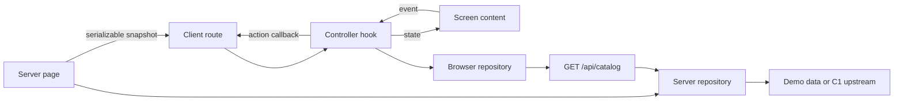

# Web application architecture

## Ownership and dependencies

One application package; folders express feature boundaries before separate packages.
Presentation depends on domain contracts. Data implements those contracts. App composition
constructs dependencies. Core contains genuinely shared infrastructure and visual primitives.
No base controller, repository, screen or generic state framework is required.

```text
src/app/                         Next routes, layout, composition and HTTP handler
  composition/server.ts         request-specific repository + snapshot assembly
  composition/client.ts         browser adapter construction
  catalog/CatalogRoute.tsx      active screen owner and transient action handling
src/core/
  config/                       public product identity; separate server environment
  result/                       small AppResult / AppError contracts
  network/                      bounded JSON consumption and deadlines
  designsystem/                 local tokens, Button and Feedback
src/feature/catalog/
  domain/                       immutable CatalogItem and CatalogRepository
  data/                         demo/HTTP/browser adapters, DTO validation and mapping
  presentation/list/            screen state, reducer, controller and content
  presentation/details/         detail rendering over the same collection contract
  presentation/components/      feature errors and reversible URL identifiers
contracts/catalog/              C1 compatibility fixtures
scripts/                        boundary/docs checks, E2E and copy workflow
```

Domain has no React/Next/env/DTO imports. Its cancellation input is the standard
AbortSignal, not a network implementation. No raw Response, Error, DTO or secret reaches
presentation. The app layer is the composition root and may assemble data implementations;
feature presentation cannot import data or app. Domain models are copied at mapping/state
boundaries. Runtime validation handles unknown JSON; TypeScript is not a JSON validator.

`npm run lint` runs ESLint plus an AST-based import graph check. The graph rejects layer
violations, cross-feature coupling, and server modules reachable from client entry points.
Next's `server-only` marker also enforces the runtime boundary at build time. The graph
covers literal module imports/exports; avoid dynamic computed imports to bypass it.

## Execution paths



Server pages call the repository directly, never their own route handler. `connection()`
selects request-time rendering before data access; builds must make zero upstream calls.
The page passes `{ initial, receivedAt }` (a domain AppResult plus timestamp) to the client.
The browser HTTP endpoint separately uses the documented wire envelope. No functions or
repository instances cross this boundary. See the official
[server/client model](https://nextjs.org/docs/app/getting-started/server-and-client-components)
and [connection API](https://nextjs.org/docs/app/api-reference/functions/connection).

A unique server snapshot key remounts the client route for new server-provided data. Normal
client renders retain the existing controller. This deliberately resets transient inputs
when a new server snapshot arrives; shareable inputs should be encoded in the URL.
The initial client render never fetches again. Explicit refresh/retry uses `/api/catalog`.

Both adapters and the handler use explicit no-store policies. There is no repository cache,
user data singleton or durable store. Browser history can restore its own route snapshot;
explicit Refresh obtains current data. Sample item links disable prefetch, keeping initial
request accounting deterministic. Server dependencies are assembled per request.

## Screen behavior

`CatalogModel.ts` owns immutable ScreenState, concrete UiState, user UiEvent and UiAction.
The controller uses a pure reducer for rendering state and owns async reads with refs.
Loading/error differ from successful data/empty. Refresh keeps the last successful snapshot;
refresh failure is nonblocking feedback. Retry eligibility is checked in the controller,
including the Retry-After deadline, even if a caller bypasses the disabled button.

Every read advances a generation and aborts the previous one. Completion applies only if
its owner is mounted, generation is current and signal is not aborted. Cleanup cancels work
and invalidates generations. Stale responses cannot reset newer state or announce completion.
Unexpected client failures are safely diagnosed and become UNKNOWN; cancellation is ignored
as control flow. Reducers, initializers and rendering perform no IO or UI actions.

The route handles the typed announce action through a callback. No action queue, replay or
consumable wrapper lives in ScreenState. The callback uses the current active handler;
important business outcomes must be durable data, never transient notifications. Effects
only manage subscriptions/cleanup; React Strict Mode is exercised by tests. See React's
[effect guidance](https://react.dev/reference/react/useEffect).

Details reuse the collection controller rather than duplicating its networking/concurrency
logic: C1 has no detail endpoint. The detail screen selects its item from the same state.
A separate details controller/model becomes useful only when that screen acquires distinct
behavior. UseCases remain optional for meaningful business operations; direct repository
reads are appropriate here.

## Navigation and error boundaries

Item navigation uses real Next Link hrefs, so keyboard, modified clicks, new tabs, history
and direct URL reloads work. IDs are opaque; a reversible UTF-16 code-unit hex path token avoids router
ambiguity for slashes, Unicode, percent signs and query characters. The source ID is never
changed. This trades human-readable URLs for unambiguous demo contract support.

A direct detail URL loads the collection and calls notFound only after a successful response
lacks its ID. Upstream 404 is an error, not a missing item. After client refresh, a removed
item displays unavailable content. Expected failures use safe feature text; `error.tsx`
handles unexpected render failures without exposing exception messages.

## Visual design and extension

`core/designsystem` contains only needed primitives and tokens. Components accept content,
values and callbacks; they know no repository, error code, routing or business rule.
Feature presentation maps semantic errors to UI messages. The sample supports system
light/dark, responsive layout, RTL logical spacing, visible focus, keyboard navigation,
reduced motion and accessible pending/error/status feedback. Decorative artwork is CSS,
hidden from assistive technology, and is not promised to depict live API items.

Build a new feature with its domain contracts, data implementation, controller if needed,
content and app composition. Use constructor/function injection and direct fakes in tests.
Add business UseCases, composed validation rules or scoped workflow owners when real logic
requires them. Do not create empty layers, a global screen store or a service locator.

Pure logic/repositories use Vitest; interactive components use Testing Library; production
SSR/handlers/hydration/navigation use Playwright. Async Server Components are not treated
as ordinary unit-renderable components; see the official
[Next.js Vitest guide](https://nextjs.org/docs/app/guides/testing/vitest).
